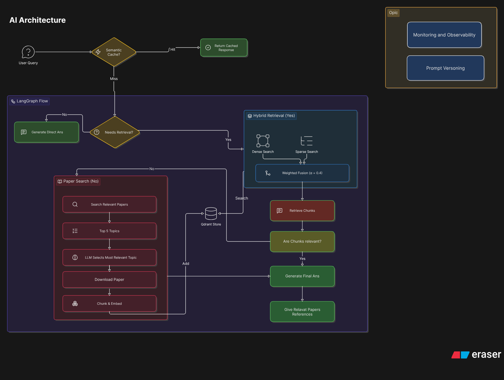
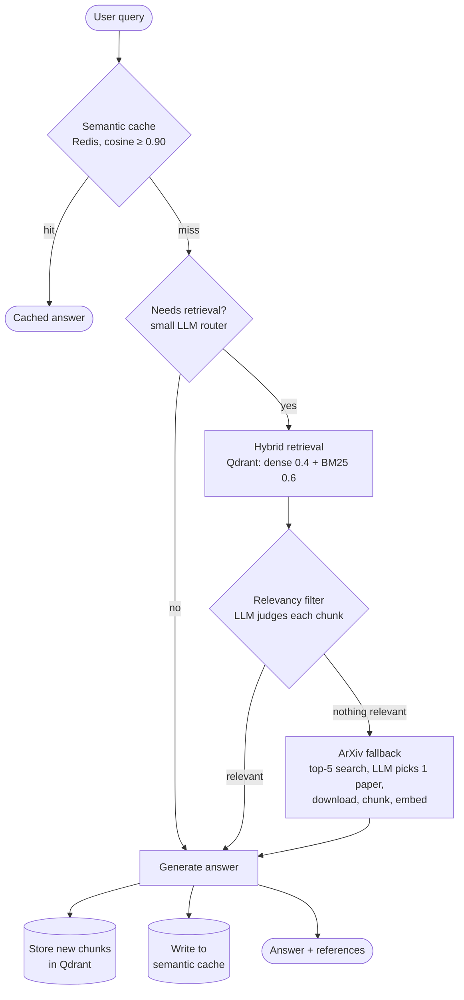

# 📚 Multi-Modal Research Paper RAG

A RAG system for asking questions about ArXiv research papers. It answers from a local hybrid-search index when it can, and when it can't, it finds the right paper on ArXiv, ingests it, and answers from that, so the index grows with use.

**Built with:** LangGraph (routing) · Qdrant (dense + BM25 hybrid retrieval) · Redis (semantic cache) · Groq (LLMs) · FastAPI · Comet Opik (tracing + prompt versioning)

| | |
|---|---|
| **Retrieval quality** | Recall@3 **91.0%**, Recall@5 **95.2%**, MRR **0.819** (paper-level, 334 queries) |
| **vs. dense-only** | Recall@3 +12.0 pts, MRR +0.12 |
| **vs. cross-encoder** | Within 0.01 MRR, at ~1 min instead of ~161 min for the full eval set |
| **Cache hit** | Skips the graph and LLM entirely (≥ 0.90 cosine similarity) |

**Jump to:** [Architecture](#-architecture-overview) · [Evaluation](#-evaluation) · [Deep dives](#-deep-dives) · [Getting started](#-getting-started)

---

## 🏗️ Architecture Overview



Every query takes one of four paths:



| Stage | What it does | Why |
|---|---|---|
| **Semantic cache** | Embeds the query and looks for a previous question with ≥ 0.90 cosine similarity in Redis. | A hit returns in milliseconds and spends no LLM tokens. |
| **Retrieval router** | A small LLM (`llama-3.1-8b-instant`) decides whether the query needs paper context. | Chit-chat shouldn't hit the vector DB. |
| **Hybrid retrieval** | Dense (`mxbai-embed-large-v1`) and sparse (BM25) search in Qdrant, fused by weighted score: `0.4·dense + 0.6·sparse`. Retrieves 10 chunks, keeps 5. | Dense catches paraphrase; BM25 catches acronyms and exact terms. See [Evaluation](#-evaluation). |
| **Relevancy filter** | An LLM judges the retrieved chunks and drops the noise. | Does the reranking job without a cross-encoder's latency. |
| **ArXiv fallback** | If nothing local is relevant, search ArXiv (top 5), have an LLM pick the best abstract, then download, chunk and embed that paper. | The system never stops at "I don't know". |
| **Continuous learning** | Newly ingested chunks are written to Qdrant. | The next related question is answered locally. |
| **Generation** | The larger model (`llama-3.3-70b-versatile`) writes the answer with references, which is then written to the cache. | |

Every graph run, LLM call and cache hit/miss is traced in Comet Opik, and all prompts are versioned in the Opik Prompt Library, not hardcoded.

📖 Full walkthrough: **[The AI Architecture: Under the Hood](./AI_architteture_blog.md)**

---

## 📊 Evaluation

### Strategy

The goal was to choose retrieval components (search type, fusion method, embedding model, reranker, image handling) from measurements and not from intuition. Everything below was evaluated on the same benchmark under the same protocol.

| | |
|---|---|
| **Benchmark** | [Open RAG Benchmark](./open_ragbench/README.md) (Vectara), the ArXiv split. It's built from real PDFs with text, tables and images. |
| **Corpus** | First **100 papers** of the benchmark, chunked (section split, then recursive 1,500 chars / 300 overlap) and indexed in Qdrant. |
| **Queries** | **334** queries whose gold paper is in that corpus. A mix of abstractive and extractive questions; 74 of them are generated from text + image content. |
| **Ground truth** | Each query maps to one gold paper (`qrels`). |
| **Scoring unit** | **Paper-level.** A retrieved chunk counts as a hit if its `paper_id` is the gold paper. |
| **Metrics** | **Recall@K** (K = 1–5): is the gold paper among the top K chunks? **MRR**: mean of 1/rank of the first chunk from the gold paper. |
| **Protocol** | Hold everything fixed except the one component under test. Report latency alongside quality, so cost is part of the decision. |

Evaluation code and raw outputs: [`Experiment_pipeline/evaluation.ipynb`](./Experiment_pipeline/evaluation.ipynb) · weighted-fusion sweeps in [`Experiment_pipeline/retrival_results/`](./Experiment_pipeline/retrival_results/)

### Results

**1. Retrieval method** (mxbai dense embeddings, 334 queries)

| Method | R@1 | R@2 | R@3 | R@4 | R@5 | MRR | Latency (334 q) |
|---|---|---|---|---|---|---|---|
| Dense only | 0.596 | 0.725 | 0.790 | 0.844 | 0.865 | 0.700 | n/a |
| Hybrid, RRF (depth 5) | 0.677 | 0.808 | 0.877 | 0.919 | 0.937 | 0.780 | 1 m 11 s |
| Hybrid, RRF (depth 10) | 0.716 | 0.826 | 0.892 | 0.919 | 0.934 | 0.809 | 1 m 15 s |
| Hybrid, ColBERT late interaction | 0.710 | 0.847 | 0.886 | 0.922 | 0.931 | 0.802 | ~1 min |
| Hybrid + cross-encoder rerank (10 chunks) | **0.746** | **0.865** | 0.901 | 0.928 | 0.949 | **0.828** | **161 min** (CPU) |
| **Hybrid, weighted fusion (α = 0.4)** ✅ | 0.728 | 0.853 | **0.910** | **0.934** | **0.952** | 0.819 | ~1 min |

**Takeaways**
- **Hybrid beats dense-only by a wide margin** (Recall@3 0.79 → 0.89–0.91). Dense-only isn't worth shipping for this corpus.
- **Weighted fusion beat RRF** once the weight was tuned (MRR 0.819 vs 0.809), and it has the best Recall@3–5 of any method tested.
- **The cross-encoder wins only on Recall@1/MRR** (+3 pts Recall@1 over RRF) and costs about 160× the time on CPU. Not worth it, so the [LLM relevancy filter](#-deep-dives) takes its place.
- **ColBERT** matched hybrid at similar cost without beating weighted fusion.

**2. Fusion weight** (mxbai, weighted fusion, sweep over dense weight 0.1 to 0.9)

| Dense / Sparse | R@1 | R@3 | R@5 | MRR |
|---|---|---|---|---|
| 0.1 / 0.9 | 0.674 | 0.889 | 0.946 | 0.780 |
| 0.3 / 0.7 | 0.710 | 0.895 | 0.952 | 0.807 |
| **0.4 / 0.6** | **0.728** | **0.910** | 0.952 | **0.819** |
| 0.5 / 0.5 | 0.713 | 0.910 | 0.952 | 0.811 |
| 0.6 / 0.4 | 0.677 | 0.898 | 0.952 | 0.788 |

BM25 deserves the larger weight here: research papers are full of acronyms and method names that dense models blur together.

**3. Dense embedding model** (each tuned over the same fusion sweep)

| Model | Best MRR | Best dense weight |
|---|---|---|
| `WhereIsAI/UAE-Large-V1` | 0.8223 | 0.4 |
| **`mixedbread-ai/mxbai-embed-large-v1`** ✅ | 0.8190 | 0.4 |
| `BAAI/bge-large-en-v1.5` | 0.8137 | 0.2 |

mxbai is the model in production. UAE scores 0.003 MRR higher but mxbai is the smaller model, so the difference doesn't justify the switch. BGE trails both.

**4. Images**

| Setup (text + image in one index) | R@5 | MRR | Images in top 5 |
|---|---|---|---|
| Text only (baseline above) | 0.952 | 0.819 | 0 |
| CLIP, same vector space as text, RRF | 0.913 | 0.791 | 460 |
| Separate image index, dual hybrid RRF | 0.925 | 0.798 | 224 |
| SigLIP, separate index, weighted (text weight 0.9) | 0.919 | 0.780 | 156 |

Mixing image hits into the same ranked list **lowered** paper-level retrieval in every configuration, and the more images surfaced, the worse it got. Images are therefore stored in their own collection (SigLIP, `google/siglip-base-patch16-512`) and fetched separately, and retrieval accuracy for text is not traded away.

> **Exploratory, not yet reproducible:** a ColPali (`vidore/colpali-v1.2`) page-image run is recorded in the notebook with Recall@1 ≈ 0.98 and MRR ≈ 0.99, but the scoring subset isn't documented and `colipali.ipynb` contains only the indexing code. Treat it as a lead, not a result.

### What shipped

`mxbai-embed-large-v1` dense + BM25 sparse → weighted fusion at **α = 0.4** → top 10 retrieved, top 5 kept → LLM relevancy filter. No cross-encoder.

---

## 🔎 Deep Dives

| Topic | Where |
|---|---|
| Chunking strategies compared (simple, recursive, parent-child, semantic, contextual) and why this project uses section split + recursive | [Research paper blog, Step 2](./research_paper_blog.md) |
| Embedding model choice and the vector store comparison | [Research paper blog, Steps 3–4](./research_paper_blog.md) |
| Dense vs. sparse vs. hybrid; RRF vs. weighted fusion | [Research paper blog, Step 5](./research_paper_blog.md) |
| Reranking: cross-encoder vs. LLM relevancy filter | [Research paper blog, Step 6](./research_paper_blog.md) |
| Evaluation dataset, metrics, full results | [Research paper blog, Step 7](./research_paper_blog.md) |
| The LangGraph state machine, caching, fallback and continuous learning | [AI architecture blog](./AI_architteture_blog.md) |

### Design notes

**Chunking.** Papers are split on Markdown headings (references dropped). Sections over 2,000 characters are split recursively into 1,500-character chunks with 300 overlap. Every chunk is prefixed with the paper title and section heading. Tables are chunked separately and carry their title.

**Semantic cache.** Redis Stack with a vector index over past queries (`COSINE`). A hit at similarity ≥ 0.90 returns the stored answer and skips the graph.

**Relevancy filter instead of a reranker.** A cross-encoder gave +3 pts Recall@1 at ~160× the evaluation time on CPU. An LLM filter already sits in the graph, drops irrelevant chunks before generation, and adds no new model to serve.

**ArXiv fallback.** Top-5 ArXiv search → an LLM selects one paper from the abstracts → PDF download → text and tables chunked and embedded (dense + sparse) → stored in Qdrant, so the answer path and the learning path are the same code.

**Observability.** Opik traces latency, token usage, retrieval counts and cache hits. Prompts (extraction, relevancy, final answer) live in the Opik Prompt Library and can be edited without a deploy.

---

## 🛠️ Tech Stack

- **Orchestration:** [LangGraph](https://langchain-ai.github.io/langgraph/)
- **LLMs (Groq):** `llama-3.1-8b-instant` (routing, filtering), `llama-3.3-70b-versatile` (generation)
- **Backend:** [FastAPI](https://fastapi.tiangolo.com/)
- **Vector DB:** [Qdrant](https://qdrant.tech/) (text and image collections)
- **Semantic cache:** [Redis Stack](https://redis.io/)
- **Observability:** [Comet Opik](https://www.comet.com/site/products/opik/)
- **Embeddings:** dense `mixedbread-ai/mxbai-embed-large-v1` (SentenceTransformers) · sparse `Qdrant/bm25` (FastEmbed) · image `google/siglip-base-patch16-512`

---

## 🚀 Getting Started

### 1. Prerequisites
- Docker (Qdrant and Redis)
- Conda / Python 3.11+

### 2. Environment variables
Create a `.env` file in the repo root:
```env
GROQ_API_KEY=your_groq_api_key
OPIK_API_KEY=your_opik_api_key
OPIK_WORKSPACE=your_opik_workspace_name
OPIK_PROJECT_NAME="Research Paper RAG Agent"
```

### 3. Start infrastructure
```bash
# Qdrant (vector DB)
docker run -p 6333:6333 -p 6334:6334 \
    -v $(pwd)/qdrant_storage:/qdrant/storage:z \
    qdrant/qdrant

# Redis Stack (semantic cache)
docker run -d --name redis -p 6379:6379 redis/redis-stack:latest
```

### 4. Run the backend
```bash
uvicorn Research_agent.backend.api.app:app --host 127.0.0.1 --port 8002 --reload
```

### 5. Run the frontend
```bash
cd Research_agent/frontend
python -m http.server 3000
```
Open `http://localhost:3000`.

---

## 🗂️ Project Structure

```
Research_agent/
├── backend/
│   ├── AI_architecture/   # LangGraph: graph, nodes, state, prompts, semantic cache, ArXiv utils
│   ├── api/               # FastAPI app and routes (chat, auth, research_paper)
│   ├── core/config.py     # Qdrant, model and app settings
│   └── utils/             # weighted fusion, SigLIP image embeddings
├── frontend/              # Static chat UI
└── specs/                 # Feature specs (authentication)
Experiment_pipeline/       # Chunking, embedding and evaluation notebooks + results
open_ragbench/             # Benchmark dataset
research_paper_rag_blog.md # Retrieval engineering blog
AI_architteture_blog.md    # Architecture blog
```
